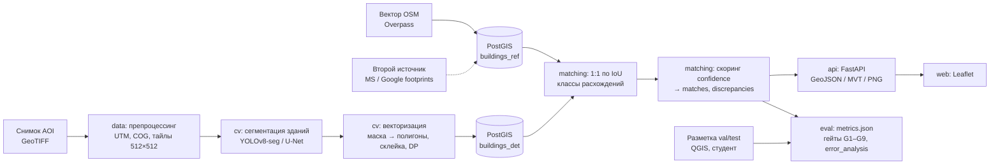

# geoqc — верификация и контроль качества геоданных о зданиях по снимкам

Курсовая работа: «Разработка алгоритма верификации и контроля качества геопространственных данных с применением методов компьютерного зрения». Автор — Жуков Д.А., БФБО-01-24. Проект выполнен оркестром ИИ-агентов под контролем студента (human-in-the-loop) и передаётся компании как воспроизводимый пайплайн.

## Что это

Картографические слои (OpenStreetMap, кадастр, корпоративные данные) устаревают: здания сносят, строят, контуры смещены. `geoqc` по аэро/спутниковому снимку детектирует здания, сопоставляет их с векторным слоем и формирует **очередь расхождений** с классом, уверенностью и картой для ручной проверки. Автоматическая правка OSM не выполняется — только очередь на ревью (Automated Edits code of conduct).

Скоуп MVP: один класс объектов (здания), одна зона 5–10 км², три класса расхождений:

| Класс | Смысл | Условие (пороги в `config/matching.yaml`) |
|---|---|---|
| `missing_in_map` | здание на снимке, нет на карте | детекция без пары, max IoU < 0.1 |
| `missing_on_image` | объект на карте, нет на снимке | эталон без пары |
| `geometry_mismatch` | контур существенно расходится | лучшая пара 0.1 ≤ IoU < 0.5 |

Пары с IoU ≥ 0.5 — совпадения (`matches`), в очередь не попадают.

## Архитектура



Подробно: [docs/architecture.md](docs/architecture.md). Формулы: [docs/metrics_and_formulas.md](docs/metrics_and_formulas.md).

## Быстрый старт

Требования: Python 3.11, Docker (PostGIS), GNU make ≥ 3.81, QGIS (для правки разметки). Порт PostGIS — **5433** (D-010).

```bash
# 1. Окружение: venv, зависимости, editable-установка, .env из примера
scripts/bootstrap.sh            # или: make install
cp -n .env.example .env         # при необходимости заполнить ARCGIS_API_KEY (только подложка)

# 2. База и схема
make up db-init                 # docker compose up -d db; geoqc matching init-db

# 3. Пайплайн
make data                       # geoqc data all: AOI, снимок, COG, тайлы, OSM, buildings_ref, геопривязка
make labels-prep                # geoqc annotation select-tiles + pre-annotate (val, test) + qgis-project → правка в QGIS (см. ниже)
make labels-validate            # geoqc annotation validate --split val|test → reports/annotation.json (G2)
make detect                     # geoqc cv fetch-weights + predict --split all --to-db        (SPLIT=val|test)
make match                      # geoqc matching run --model-version <config/cv.yaml> + export + stats   (MODEL_VERSION=<v>)
make eval                       # geoqc eval detection val+test, verification-sample, discrepancies (если есть reports/verification.csv),
                                #   error-analysis, compare-secondary, gates → reports/metrics.json     (VERIFICATION=<csv>)
make demo                       # up db-init + geoqc api serve → http://localhost:8000        (или make demo-docker)

make all                        # = up db-init data detect match eval
make test lint                  # pytest (без network/slow/gpu), ruff
```

Каждый make-таргет — обёртка над CLI-командой из `docs/CONTRACTS.md` §6; полный список и переменные — `make help`, команды — `geoqc --help`, `geoqc <module> --help`. Дополнительные таргеты: `db-init-test`, `demo-docker`, `bundle`, `test-all`, `test-cov`, `format`, `notebooks-check`, `compose-config`, `docker-build`, `ci`, `pre-commit`, `clean`.

### Команды CLI по модулям

| Модуль | Команды | Главные выходы |
|---|---|---|
| `geoqc data` | `search-aoi` `download` `preprocess` `tile` `osm` `secondary` `load-ref` `check-georef` `all` | `data/manifest.json`, `data/interim/aoi_cog.tif`, `data/tiles/`, `buildings_ref`, `reports/georef.json` |
| `geoqc annotation` | `select-tiles` `pre-annotate --split val\|test --source secondary\|detections` `qgis-project` `validate --split`; сверх контракта — `finalize` (рабочий `work.gpkg` из QGIS → `buildings.geojson` / `recheck.geojson`) | `data/labels/tiles_split.csv`, `data/labels/<split>/draft.geojson`, `data/labels/<split>/buildings.geojson`, `reports/annotation.json` |
| `geoqc cv` | `fetch-weights` `predict --split all\|val\|test [--to-db]` `export-dataset` `bundle` `threshold-sweep --split val` | `data/interim/detections.geojson`, `buildings_det`, `data/interim/bundle.zip`, `reports/threshold_sweep_val.json` |
| `geoqc matching` | `init-db` `run --model-version <v>` `export` `stats` | `matches`, `discrepancies`, `reports/discrepancies.geojson` |
| `geoqc eval` | `detection --split val\|test` `verification-sample` `discrepancies --verification reports/verification.csv` `error-analysis` `compare-secondary` `gates` | `reports/metrics_<split>.json`, `reports/verification_sample.csv`, `reports/error_analysis.md`, `reports/metrics.json` |
| `geoqc api` | `serve [--host --port]`; сверх контракта — `bench` (замер `GET /discrepancies` на тестовой БД) | http://localhost:8000 (карта), `/health`, `/discrepancies`, `/export` |

Свой снимок вместо открытого: `geoqc data preprocess --input path/to/image.tif` (любой GeoTIFF, GSD ≤ 0.5 м).

## Структура репозитория

```
Makefile  docker-compose.yml  Dockerfile  pyproject.toml  requirements.txt  requirements-dev.txt
config/            aoi.geojson  pipeline.yaml  quality_gates.yaml  <module>.yaml
data/              raw/  interim/  tiles/  labels/{val,test}/  manifest.json      (растры не в git)
sql/               001_schema.sql (контракт)  002+_*.sql (сопоставление)
src/geoqc/         config.py  db.py  cli.py  data/  annotation/  cv/  matching/  eval/  api/
web/               Leaflet SPA (статика, отдаёт FastAPI по /)
notebooks/         train_finetune.ipynb — дообучение (локально / Colab)
tests/             conftest.py  <module>/  integration/
reports/           metrics.json  metrics_val.json  metrics_test.json  error_analysis.md  figures/
docs/              CONTRACTS.md  tasks/  annotation/  qa/  thesis/  presentation/  *.md
models/            MODEL_CARD.md (+ веса, не в git)
PLAN.md  DECISIONS.md  LOG.md  README.md
```

Контракты данных, CLI и API — `docs/CONTRACTS.md`; журнал решений — `DECISIONS.md`; журнал работы агентов — `LOG.md`.

## Контрольные точки человека

Пайплайн не подменяет три шага, которые выполняет студент:

1. **Разметка эталона в QGIS** (после `make labels-prep`). Черновые контуры (`data/labels/<split>/draft.geojson`) правятся и подтверждаются (`verified=true`) по [docs/annotation/INSTRUCTION_QGIS.md](docs/annotation/INSTRUCTION_QGIS.md) и протоколу [docs/annotation/PROTOCOL.md](docs/annotation/PROTOCOL.md); 10 % тайлов размечаются повторно «вслепую» (`recheck.geojson`) для гейта G2. Выгрузка из рабочего GeoPackage — `geoqc annotation finalize`; приёмка — `make labels-validate` (`geoqc annotation validate --split val|test`). OSM эталоном **не является** — его мы проверяем (D-005).
2. **Дообучение модели** (если бейзлайн не проходит G3 на `val`): `make bundle` → `notebooks/train_finetune.ipynb` локально (CUDA/MPS/CPU) или в Colab (D-004); после обучения веса кладутся в `models/`, `model_version` обновляется в `config/cv.yaml` и `models/MODEL_CARD.md`. `data/labels/test/` в обучении и подборе порогов не участвует — проверяется статическим тестом QA.
3. **Ручная верификация расхождений** (≥ 50 шт., по классам): `geoqc eval verification-sample` → `reports/verification_sample.csv`; студент заполняет `verdict ∈ {map_error, model_error, image_issue, unsure}` → сохраняет как `reports/verification.csv` → `geoqc eval discrepancies --verification reports/verification.csv` (гейты G6, G7).

Веб-сценарий для валидатора: выбрать зону → список расхождений по убыванию `confidence` → карточка (класс, confidence, IoU, ссылка на osm.org) → «Принять / Отклонить» (`PATCH /discrepancies/{id}`) → «Экспорт GeoJSON» (`/export`, формат пригоден для MapRoulette / JOSM).

## Метрики и гейты

Все числа порождаются кодом и лежат в `reports/` (`metrics.json`, схема §3.9 контрактов). Пороги G1–G9 — `config/quality_gates.yaml`, они не меняются после получения результатов на `test`. Непройденный гейт не скрывается: в отчёте фактическое значение, причина и fallback. Определения — [docs/metrics_and_formulas.md](docs/metrics_and_formulas.md).

## Лицензии и атрибуция

| Компонент | Лицензия / условия | Где зафиксировано |
|---|---|---|
| Код `geoqc` | MIT | `pyproject.toml`, `LICENSE` |
| Векторный слой OSM | ODbL; атрибуция «© участники OpenStreetMap» на карте и в отчёте | `data/manifest.json → osm` |
| Снимок AOI | лицензия источника (OpenAerialMap CC-BY 4.0 / Maxar Open Data CC BY-NC 4.0 / пользовательский); URL, дата, sha256, атрибуция | `data/manifest.json → image`, `DECISIONS.md` D-001/D-001a |
| Второй источник | Microsoft GlobalMLBuildingFootprints (ODbL) / Google Open Buildings (CC BY 4.0) | `data/manifest.json → secondary` |
| Веса модели | лицензия чекпоинта (Ultralytics YOLOv8 — AGPL-3.0; иные — по карточке) | `models/MODEL_CARD.md` |
| Esri World Imagery | **только XYZ-подложка** в Leaflet/QGIS с атрибуцией и ключом `ARCGIS_API_KEY`; массовая выгрузка и обучение запрещены | `DECISIONS.md` D-002 |

Детекция и метрики считаются только по открытому снимку из манифеста. Секреты — только в `.env` (не в git).

## Ограничения

- Разновременность: дата снимка и дата среза OSM различаются (обе в манифесте); часть `missing_*` — реальные изменения, а не ошибки карты.
- Контуры крыш vs фундаментов: off-nadir съёмка, тени, растительность смещают контур; протокол разметки фиксирует, что размечается.
- Разрешение снимка задаёт минимальный детектируемый объект; Sentinel-2 (10 м) для отдельных зданий непригоден.
- Один снимок, один срез вектора: мониторинг во времени, другие классы объектов, покрытие города — направления развития.
- Вычисления: CPU/MPS-инференс или один GPU уровня T4 (Colab); обучение с нуля не планировалось.
- Метрики верификации (G6, G7) зависят от объёма ручной проверки (≥ 50 расхождений) и корректности вердиктов.

## Документация

- Контракты: [docs/CONTRACTS.md](docs/CONTRACTS.md) · ТЗ агентов: `docs/tasks/`
- Архитектура: [docs/architecture.md](docs/architecture.md)
- Формулы и метрики: [docs/metrics_and_formulas.md](docs/metrics_and_formulas.md)
- План ведения документации: [docs/DOCUMENTATION_PLAN.md](docs/DOCUMENTATION_PLAN.md)
- Разметка: `docs/annotation/PROTOCOL.md`, `docs/annotation/INSTRUCTION_QGIS.md`, `data/labels/README.md`
- Ноутбук обучения: `notebooks/README.md` · Карточка модели: `models/MODEL_CARD.md`
- README модулей: `src/geoqc/data/README.md`, `src/geoqc/annotation/README.md`, `src/geoqc/cv/README.md`, `src/geoqc/matching/README.md`, `src/geoqc/eval/README.md`, `src/geoqc/api/README.md`
- Отчёт QA: `docs/qa/`
- Пояснительная записка: [docs/thesis/00_outline.md](docs/thesis/00_outline.md) · Презентация: [docs/presentation/outline.md](docs/presentation/outline.md)
- Исходный план курсовой: [docs/plan_source.md](docs/plan_source.md)
