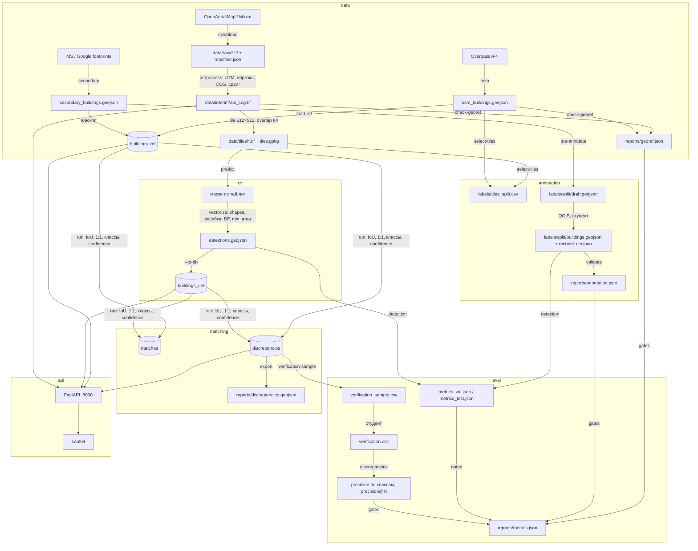
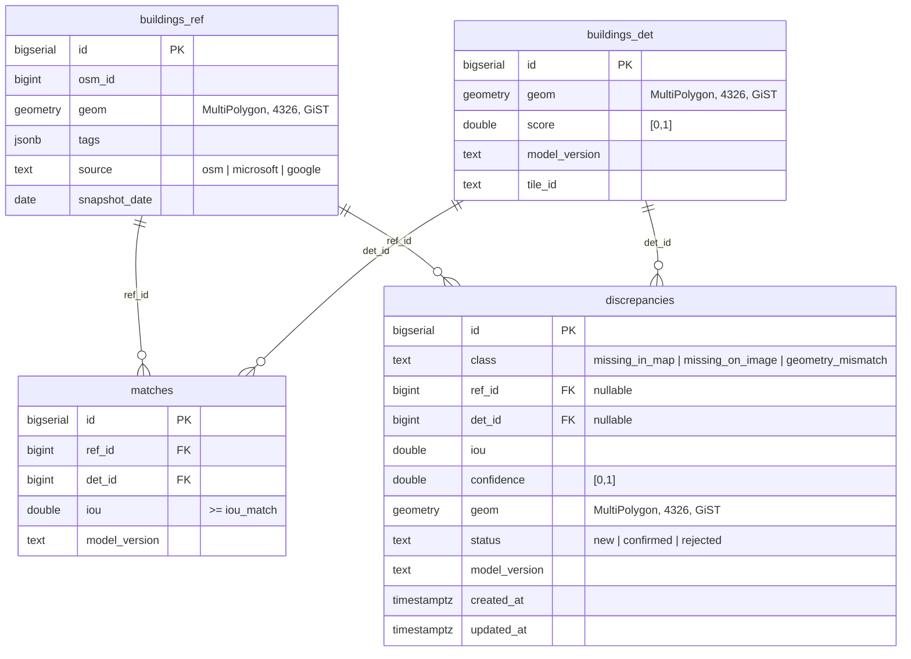

# Архитектура geoqc

Источник истины по интерфейсам — `docs/CONTRACTS.md`. Здесь — как компоненты связаны, какие данные текут между ними и где что лежит.

## 1. Компоненты

| Модуль (`src/geoqc/<module>`) | Роль | Входы | Выходы |
|---|---|---|---|
| `data` | AOI, снимок, вектор, тайлы, загрузка эталона, проверка геопривязки | OpenAerialMap / Maxar Open Data, Overpass API, MS/Google footprints, `config/aoi.geojson` | `data/raw/*.tif`, `data/manifest.json`, `data/interim/aoi_cog.tif`, `data/tiles/`, `data/interim/osm_buildings.geojson`, `data/interim/secondary_buildings.geojson`, таблица `buildings_ref`, `reports/georef.json`, `reports/aoi_candidates.json` |
| `annotation` | отбор тайлов, предразметка, валидация эталона, G2, проект QGIS | `tiles.gpkg`, `osm_buildings.geojson`, `secondary_buildings.geojson` или `detections.geojson` | `data/labels/tiles_split.csv`, `data/labels/<split>/draft.geojson`, `reports/annotation.json`, проект `.qgz` / стили `.qml` |
| `cv` | веса, инференс по тайлам, векторизация масок, склейка, датасет для дообучения, подбор порога на `val`, детекция на загруженном снимке | `data/tiles/*.tif`, `config/cv.yaml`, `models/` | `data/interim/detections.geojson`, таблица `buildings_det`, `data/interim/dataset/`, `reports/threshold_sweep_val.json`, `models/MODEL_CARD.md` |
| `matching` | 1:1 сопоставление ref↔det по IoU, классификация, скоринг, экспорт очереди | `buildings_ref` (`source='osm'` — эталон; `microsoft`/`google` — второй источник), `buildings_det`, `config/matching.yaml` | таблицы `matches`, `discrepancies`, `reports/discrepancies.geojson` |
| `eval` | метрики детекции, верификационная выборка, precision расхождений, сравнение с вторым источником, анализ ошибок, гейты | `data/labels/{val,test}/buildings.geojson`, `detections.geojson`, `discrepancies`, `reports/*.json`, `reports/verification.csv`, `config/quality_gates.yaml` | `reports/metrics_val.json`, `reports/metrics_test.json`, `reports/verification_sample.csv`, `reports/error_analysis.md`, `reports/figures/`, `reports/metrics.json` |
| `api` + `web/` | FastAPI: GeoJSON, MVT, тайлы снимка, статусы, экспорт; Leaflet-карта | PostGIS, `data/interim/aoi_cog.tif`, `config/aoi.geojson`, `data/manifest.json`, `.env` | HTTP :8000 |
| корень пакета | `config.py` (слияние `config/*.yaml`, `.env`), `db.py` (psycopg 3, `apply_schema`), `cli.py` (typer, авто-подключение саб-приложений) | — | — |

Изоляция ответственности: каждый модуль пишет только в свои пути (матрица владения — CONTRACTS §1). `data/labels/test/` недоступен модулю `cv` и ноутбуку; читают его только `annotation`, `eval`, QA.

## 2. Поток данных

## 3. Системы координат

| Где | CRS | Зачем |
|---|---|---|
| PostGIS, GeoJSON, GPKG, `detections.geojson`, `labels/*.geojson` | EPSG:4326 | хранение и обмен |
| `data/interim/aoi_cog.tif`, `data/tiles/*.tif` | метрическая UTM-зона AOI | тайлинг без искажений, пиксель ↔ метр |
| площади, IoU, буферы, смещения, DP-упрощение, `min_area_m2` | та же UTM-зона | метрические величины |

Код зоны: `config/pipeline.yaml → crs.metric` (заполняет Data Agent после выбора AOI), дублируется в `data/manifest.json → aoi.utm_epsg`. Функция выбора — `geoqc.data.crs.utm_epsg_for(lon, lat) -> int`. В SQL метрические вычисления делаются через `ST_Transform(geom, metric_srid)` внутри функций `sql/002_matching.sql`.

## 4. База данных (`sql/001_schema.sql`)

- `matches` отделена от `discrepancies` (D-008): пары IoU ≥ `iou_match` нужны для G5, но расхождениями не являются. Уникальность `(ref_id, model_version)` и `(det_id, model_version)` гарантирует 1:1.
- Идемпотентность: `matching run` удаляет строки своего `model_version` перед вставкой; `data load-ref` — `DELETE WHERE source=...`.
- Индексы: GiST по `geom` во всех таблицах, `(class, confidence DESC)` и `status` в `discrepancies` — под запросы API с `bbox`, фильтром и сортировкой.
- `sql/002_matching.sql` (Geo): функции `geoqc_iou`, `geoqc_candidate_pairs`, `geoqc_match_greedy`, NMS (`det_suppressed`), разбиение мультиполигонов, классификация, а также таблица `discrepancy_features` (признаки за каждым `confidence`). Применяются `geoqc matching init-db` (`geoqc.db.apply_schema` — все `sql/NNN_*.sql` по порядку). Детали — `src/geoqc/matching/README.md`.
- Две БД в одном контейнере: `geoqc` (рабочая) и `geoqc_test` (тесты с маркером `db`, фикстура `db_conn` применяет схему и очищает таблицы).

## 5. Последовательность make-таргетов

Сверено с `Makefile` (GNU make 3.81, переменные `PY`, `GEOQC`, `SPLIT`, `PRE_SOURCE`, `VERIFICATION`, `MODEL_VERSION`, `HOST`, `PORT`).

| Таргет | Что вызывает | Предусловие | Артефакты |
|---|---|---|---|
| `install` | `scripts/bootstrap.sh`: venv, `requirements-dev.txt`, `pip install -e .`, `.env` из примера, pre-commit | Python 3.11 | `.venv/`, `.env` |
| `up` / `down` | `docker compose up -d --wait db` / `down` | Docker | контейнер `geoqc-db` :5433 |
| `db-init` | `geoqc matching init-db` | `up` | таблицы и функции `sql/` |
| `db-init-test` | `scripts/db_init.py --test` | `up` | схема в `geoqc_test` |
| `data` | `geoqc data all` | `db-init`, сеть (whitelist) | см. §1, строка `data` |
| `labels-prep` | `geoqc annotation select-tiles`; `pre-annotate --split val|test --source $(PRE_SOURCE)`; `qgis-project` | `data` | `tiles_split.csv`, `draft.geojson`, проект QGIS → **правка студентом** |
| `labels-validate` | `geoqc annotation finalize` + `validate` для `train`, `val`, `test` | разметка `verified=true` в QGIS (`work.gpkg`) | `data/labels/<split>/buildings.geojson`, `reports/annotation.json` (G2) |
| `detect` | `geoqc cv fetch-weights`; `predict --split $(SPLIT) --to-db` | `data` | `detections.geojson`, `buildings_det` |
| `match` | `geoqc matching run --model-version $(MODEL_VERSION)` (по умолчанию `config/cv.yaml → model_version`); `export`; `stats` | `detect`, `data` | `matches`, `discrepancies`, `reports/discrepancies.geojson` |
| `eval` | `geoqc eval detection --split val`, `--split test`; `verification-sample`; `discrepancies --verification $(VERIFICATION)` (только если файл есть); `error-analysis`; `compare-secondary`; `gates` | `match`, эталон, `reports/verification.csv` | `reports/metrics*.json`, `verification_sample.csv`, `error_analysis.md`, `figures/` |
| `demo` | `up db-init` → `geoqc api serve --host $(HOST) --port $(PORT)` | `match` | http://localhost:8000 |
| `demo-docker` | `docker compose up -d --build --wait db app` | Docker | то же в контейнере |
| `all` | `up db-init data detect match eval` | — | всё выше |
| `test` / `test-all` / `test-cov` | `pytest -m "not network and not slow and not gpu"` / все тесты с `GEOQC_NETWORK=1` / с покрытием | `install` | `coverage.xml` |
| `lint` / `format` | `ruff format --check . && ruff check .` / с исправлением | `install` | — |
| `notebooks-check` | `scripts/ci/check_notebooks.sh` (nbqa ruff, `nbstripout --verify`) | — | — |
| `compose-config` / `docker-build` | `docker compose config -q` / `docker build -t geoqc-app:local .` | Docker | образ |
| `ci` | `lint test-cov notebooks-check compose-config` | `install` | локальный эквивалент GitHub Actions |
| `pre-commit` / `clean` | установка хуков / удаление кэшей (данные, модели, отчёты сохраняются) | — | — |

Шаги человека встроены между таргетами: `labels-prep → QGIS → geoqc annotation finalize → labels-validate`, `detect → (ноутбук при провале G3) → match`, `match → verification.csv → eval`. При расхождении с этой таблицей прав `Makefile` (`make help`).

## 6. API и веб-клиент

- `GET /health`, `GET /stats`, `GET /config/map` (центр/bbox из `config/aoi.geojson`, атрибуции из `data/manifest.json`, `esri_enabled`).
- `GET /discrepancies?bbox&class&min_conf&status&limit&offset` → GeoJSON, сортировка `confidence DESC`; `GET /discrepancies/{id}`; `PATCH /discrepancies/{id}` `{"status": ...}`.
- `GET /tiles/{z}/{x}/{y}.mvt` — слои `discrepancies`, `buildings_ref`, `buildings_det` (`ST_AsMVT`); `GET /imagery/{z}/{x}/{y}.png` — тайлы COG (rio-tiler); `GET /export` — контракт §3.8.
- Esri-подложка — только через серверный прокси с подстановкой `ARCGIS_API_KEY` (ключ на клиент не уходит), см. D-002.
- `web/` — Leaflet без сборщика: подложки (OSM / снимок / Esri), слои по классам, фильтры, список топ-N, подсветка объекта, экспорт.

## 7. Конфигурация и секреты

- `config/pipeline.yaml` — пути, CRS, тайлинг, seed (координатор). `config/quality_gates.yaml` — пороги G1–G9. `config/<module>.yaml` — параметры модуля (владелец).
- `geoqc.config.load_config()` собирает всё в один словарь: `cfg["matching"]["iou_match"]`, `cfg["gates"]["G3"]["target"]`.
- Секреты — только `.env` (`DATABASE_URL`, `TEST_DATABASE_URL`, `ARCGIS_API_KEY`), доступ `geoqc.config.get_settings()`.

## 8. Где что лежит

| Что | Путь | В git |
|---|---|---|
| исходный снимок, COG, тайлы, маски, датасет | `data/raw/`, `data/interim/`, `data/tiles/` | нет (кроме `manifest.json`, `tiles.gpkg`) |
| эталонная разметка | `data/labels/{val,test}/`, `tiles_split.csv` | да |
| веса модели | `models/` | нет (карточка — да) |
| отчёты и рисунки | `reports/` | да (`json`, `md`, `png`) |
| документация | `README.md`, `docs/` | да |
| ноутбук дообучения | `notebooks/train_finetune.ipynb` (без outputs, `nbstripout`) | да |

## 9. Воспроизводимость и тесты

- `make all` в чистом окружении — гейт G8; `pytest` — G9 (покрыты сопоставление и классификация на синтетических геометриях).
- CI — GitHub Actions (D-003): `lint`, `test` (PostGIS-сервис), `docker`, `notebooks`.
- Детерминизм: `random_seed` в `config/pipeline.yaml`, фиксированные сплиты, `model_version = "<model_name>-<weights_sha256[:8]>"`.
