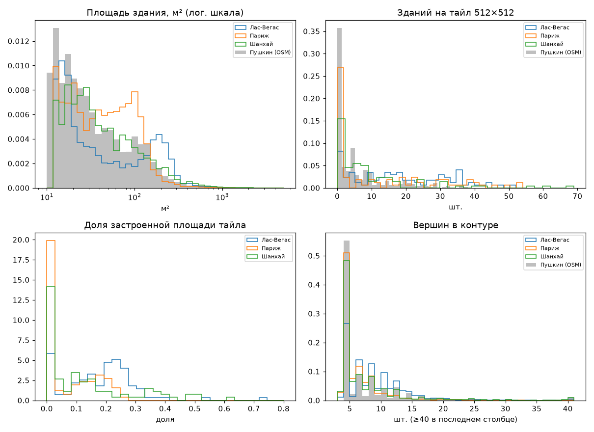
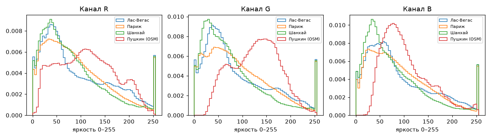
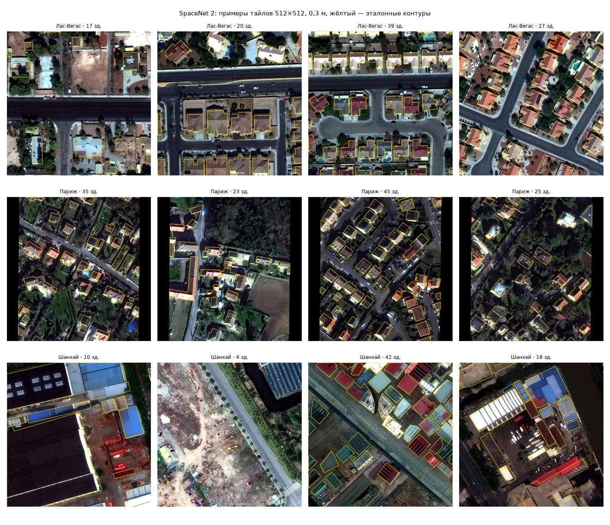
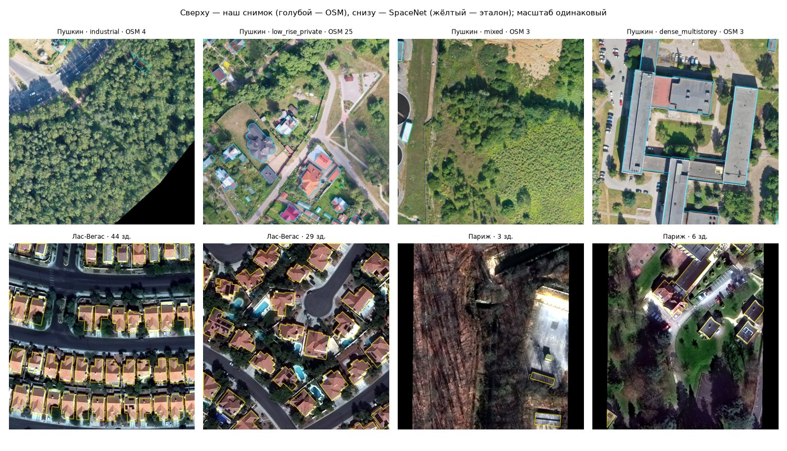
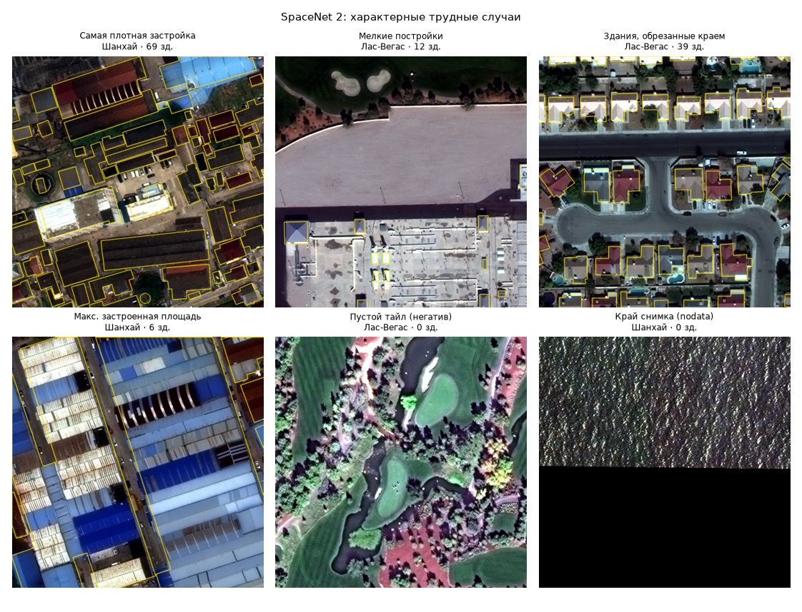

# SpaceNet 2 Buildings — внешний размеченный датасет

Зачем: проверить весь путь обучения (ноутбук, экспорт весов, инференс), пока разметка `val` не проверена,
и увидеть на готовой разметке, как размечать свой набор. **Метрики на SpaceNet — не метрики работы**:
G3 считается только на нашем `val`, `test` используется один раз (D-015).

## Источник и лицензия

| | |
|---|---|
| Набор | SpaceNet 2 Buildings, часть `train` (у `test_public` нет разметки) |
| Сенсор | Maxar WorldView-3, pan-sharpened RGB (`PS-RGB`), uint16, 650×650 px, EPSG:4326, 2.7e-6° (~0.3 м) |
| Бакет | `https://spacenet-dataset.s3.amazonaws.com/spacenet/SN2_buildings/train/<AOI>/` — публичный, без ключей AWS |
| Лицензия | CC BY-SA 4.0 |
| Атрибуция | «SpaceNet on AWS (SpaceNet Partners, Maxar WorldView-3), CC BY-SA 4.0» |
| Города | `AOI_3_Paris`, `AOI_4_Shanghai`, `AOI_2_Vegas` (Хартум не берём: сухая застройка без зелени дальше всего от нашего AOI) |

CC BY-SA распространяется на производные данные (чипы, маски). Веса, обученные на них, в карточке модели
помечаются источником. Сами данные в git не попадают (`data/` в `.gitignore`); `SOURCE.json` рядом с сырыми
файлами фиксирует лицензию, seed и дату загрузки.

## Команды

```bash
make external-data                       # = три команды ниже
geoqc cv fetch-external [--city AOI_3_Paris ...] [--per-city 100]
geoqc cv prepare-external [--city ...] [--out data/interim/external/spacenet2]
geoqc cv report-external [--per-city 4]  # рисунки docs/datasets/figures/ + reports/external_spacenet2.json
```

Параметры — блок `external:` в `config/cv.yaml`. Выборка тайлов детерминирована (`seed 42`), повторная загрузка
берёт файлы из кэша (`data/raw/external/spacenet2`, ~790 МБ при 100 тайлах на город).

В ноутбуке `notebooks/train_finetune.ipynb`: `DATA_SOURCE = "spacenet"` (+ `SMOKE_TEST = True`) — прогон без нашей
разметки, `config/cv.yaml` и карточка модели не меняются; `"val+spacenet"` — SpaceNet добавляется к train, holdout и
порог — только по `val`.

## Подготовка чипа

1. Тайл перепроецируется в локальную UTM-зону (`utm_epsg_for` по центру тайла) с квадратным пикселем
   $g = 0.3$ м — как наши тайлы. Чип $512 \times 512$ px ($153.6$ м) центрирован на тайле, ресэмплинг билинейный,
   nodata = 0. Узкий по долготе тайл (650 px × 0.197 м ≈ 128 м в Париже, широта 49°) даёт чёрные поля по бокам.
2. Растяжка каждого канала $b$ по валидным пикселям:
   $$v' = \operatorname{clip}\!\left(255\cdot\frac{v - P_2(b)}{P_{98}(b) - P_2(b)},\,0,\,255\right),$$
   пиксели nodata остаются 0.
3. Полигоны переводятся в UTM, обрезаются по чипу; отбрасываются площадью $< 12$ м² (как `annotation.min_area_m2`)
   и те, у которых $< 50\%$ площади над валидными пикселями. Здание, обрезанное краем чипа, помечается `partial`.
4. Чип пропускается, если доля валидных пикселей $< 0.5$ (`min_valid_fraction`); в выборке таких 12 из 300.
5. Сплит train/holdout 80/20, стратифицирован по городу (`split_tiles`). Выход повторяет `export_dataset`:
   `images/{train,holdout}/*.png`, YOLO-seg `labels/*.txt`, маски `masks/*.png`, `data.yaml`, `split.csv`,
   `buildings.gpkg`, `meta.json`.

## Состав

Источник цифр — `reports/external_spacenet2.json` (описательная статистика, не метрики модели).

| | Париж | Шанхай | Вегас | **Наш AOI (OSM)** |
|---|---:|---:|---:|---:|
| Чипов / тайлов | 93 | 96 | 99 | 354 тайла |
| Зданий | 1141 | 902 | 1830 | 1516 |
| Зданий на чип, среднее | 12.3 | 9.4 | 18.5 | 5.6 |
| Пустых чипов | 46% | 26% | 10% | 38% |
| Обрезано краем чипа | 14% | 34% | 33% | — |
| Площадь, медиана, м² | 89 | 123 | 180 | 105 |
| Площадь, p90, м² | 195 | 594 | 353 | 604 |
| Доля < 50 м² | 25% | 24% | 16% | 30% |
| Доля > 500 м² | 2% | 12% | 6% | 11% |
| Вершин, медиана | 4 | 4 | 8 | 4 |
| Прямоугольность, медиана | 0.94 | 0.92 | 0.88 | 0.998 |
| Касаются соседа (≤ 0.5 м) | 6% | 10% | 1% | 7% |
| Средний RGB | 90 / 92 / 91 | 82 / 79 / 79 | 94 / 91 / 91 | 113 / 127 / 105 |

Прямоугольность — площадь полигона / площадь минимального описанного прямоугольника. Для AOI здание
считается в каждом тайле, куда попал его центроид (тайлы перекрываются). Итого 288 чипов
(229 train, 59 holdout), 3873 здания.





## Примеры

Контуры разметки SpaceNet — жёлтые.



Наши тайлы `val` с контурами OSM (не разметка) рядом с SpaceNet:



Трудные случаи: самый плотный чип, мелкие постройки, обрезка краем, максимальное покрытие, пустой чип, край nodata.



## Наблюдения

* **Разметка неполная.** В Париже часть домов и сараев не обведена (`img100`); у торгового центра в Вегасе обведены
  надстройки на крыше, а не здание. Модель, обученная на таком, учится пропускать мелочь.
* **Слитые здания.** Соседние цеха в Шанхае иногда размечены одним полигоном.
* **Съёмка.** Париж — зима (деревья без листвы), длинные тени, заметный off-nadir: видны стены, крыша сдвинута
  относительно основания. Шанхай — большие промышленные крыши синего и красного цвета. Вегас — регулярная
  малоэтажная застройка с оранжевой черепицей.
* **Домен.** Наш UAV-снимок летний, светлее и зеленее (G выше R и B на 15–23 единицы против ровного серого у SpaceNet).
  При обучении на SpaceNet нужны цветовые аугментации (HSV, яркость, контраст).
* **Масштаб.** Медиана площади у нас близка к Парижу и Шанхаю, хвост крупных зданий — как у Шанхая. Мелких построек
  больше (30% < 50 м²), зданий на тайл меньше, пустых тайлов много: модели нужны отрицательные примеры.
* **OSM у нас ортогонализован** (прямоугольность 0.998), SpaceNet обведён по снимку (0.88–0.94). Предразметка из OSM
  выглядит аккуратнее, чем реальный контур крыши, — её надо двигать под снимок, а не наоборот.
* **Здания под кронами.** На «промышленном» тайле часть зданий OSM не видна под деревьями — источник
  `missing_on_image`, который детектор честно не найдёт.

## Что взять для своей разметки (`docs/annotation/PROTOCOL.md`)

1. Обводить здание целиком по крыше, не надстройки и не тень; при наклоне съёмки — по крыше, а не по стене.
2. Размечать всё видимое на тайле, включая сараи и гаражи от 12 м²: пропуск — это ложный отрицательный пример.
3. Соседние здания разделять по видимой границе крыш (перепад высоты, цвета, парапет), не сливать в один полигон.
4. Здание, обрезанное краем тайла, размечать в пределах тайла (`finalize` обрежет сам).
5. Пустой тайл — тоже разметка: тайл без зданий подтверждается, а не пропускается.
6. Здание, не видное из-за крон, не рисовать по OSM; спорные — в слой `recheck`.

## Ограничения

* Другой сенсор (спутник vs UAV), сезон и регион: цифры на holdout SpaceNet о нашем AOI ничего не говорят.
* 100 тайлов на город — выборка для smoke-обучения и анализа, не для полноценного предобучения;
  `--per-city 0` берёт все тайлы (десятки ГБ).
* Разметка SpaceNet — сама по себе с пропусками (см. выше), это шум в обучении.
