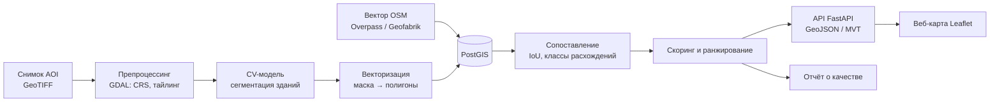

# Разработка алгоритма верификации и контроля качества геопространственных данных с применением методов компьютерного зрения

**Автор:** Жуков Д.А., БФБО-01-24
**Формат исполнения:** оркестр ИИ-агентов под контролем студента (human-in-the-loop)
**Срок:** 14 рабочих дней (+ буфер)

---

## 0. Сводка

**Проблема.** Картографические данные (OpenStreetMap, кадастр, корпоративные слои) устаревают и содержат ошибки: пропущенные здания, снесённые объекты, смещённые или неверные контуры. Ручная сверка со снимками дорогая и не масштабируется.

**Продукт.** Сервис контроля качества геоданных: по спутниковому/аэроснимку детектирует здания, сопоставляет их с векторным слоем и выдаёт очередь расхождений с классом, уверенностью и визуализацией на карте.

**Результат курсовой:**
1. Воспроизводимый пайплайн `снимок + вектор → детекция → сопоставление → отчёт о расхождениях`.
2. Размеченный тестовый набор и измеренные метрики качества.
3. Веб-карта с расхождениями + API.
4. Пояснительная записка и презентация.

---

## 1. Продуктовая постановка

| Параметр | Значение |
|---|---|
| Пользователь | Картограф / валидатор данных / GIS-аналитик |
| Ключевой сценарий | Выбрать зону → получить список подозрительных объектов, отсортированный по уверенности → просмотреть на карте → принять/отклонить |
| Ценность | Сокращение времени ручной проверки: смотреть только на объекты-кандидаты, а не на всю территорию |
| Метрика ценности | Доля реальных ошибок среди топ-N кандидатов (precision@N) |

**В скоупе MVP:**
- один тип объектов — здания;
- одна тестовая зона (AOI) 5–10 км² с разнородной застройкой;
- три класса расхождений: `missing_in_map`, `missing_on_image`, `geometry_mismatch`;
- статическая оценка (один снимок, один срез вектора).

**Вне скоупа:** дороги и прочие классы объектов, автоматическая правка OSM, покрытие целого города, обучение модели с нуля, мониторинг во времени (только как направление развития).

---

## 2. Архитектура решения



**Стек:** Python 3.11, GDAL/rasterio, shapely/geopandas, PyTorch, Ultralytics YOLOv8-seg и/или SAM, PostgreSQL + PostGIS, FastAPI, Leaflet, Docker Compose, Airflow (опционально), pytest.

---

## 3. Оркестр агентов

### 3.1 Роли

| Агент | Зона ответственности | Основные артефакты |
|---|---|---|
| **Orchestrator** | Планирование, декомпозиция, выдача задач, приёмка по DoD, ведение журнала решений | `PLAN.md`, `DECISIONS.md`, статусы задач |
| **Data Agent** | Загрузка снимков и вектора, препроцессинг, тайлинг, загрузка в PostGIS | `data/`, `src/data/`, манифест данных |
| **Annotation Agent** | Подготовка ручной разметки тестового набора, контроль качества разметки | `data/labels/`, протокол разметки |
| **CV Agent** | Выбор, инференс и дообучение модели, векторизация масок | `src/cv/`, веса, карточка модели |
| **Geo Agent** | Схема БД, SQL-сопоставление, классификация расхождений, скоринг | `sql/`, `src/matching/` |
| **Eval Agent** | Независимое измерение метрик, анализ ошибок | `reports/metrics.json`, `reports/error_analysis.md` |
| **App Agent** | API, веб-карта, упаковка в Docker | `src/api/`, `web/`, `docker-compose.yml` |
| **QA/Review Agent** | Код-ревью, тесты, проверка воспроизводимости, соблюдение ограничений | ревью-комментарии, `tests/` |
| **Docs Agent** | Пояснительная записка, презентация, README | `docs/`, `README.md` |
| **Студент (human)** | Утверждение на контрольных точках, ручная верификация выборки, защита | подписи на гейтах |

### 3.2 Матрица разрешённых действий

| Действие | Orch | Data | Annot | CV | Geo | Eval | App | QA | Docs |
|---|---|---|---|---|---|---|---|---|---|
| Читать весь репозиторий | ✅ | ✅ | ✅ | ✅ | ✅ | ✅ | ✅ | ✅ | ✅ |
| Писать в свою директорию | ✅ | ✅ | ✅ | ✅ | ✅ | ✅ | ✅ | ✅ (`tests/`) | ✅ |
| Писать в чужую директорию | ❌ | ❌ | ❌ | ❌ | ❌ | ❌ | ❌ | ❌ | ❌ |
| Сетевые загрузки (whitelist) | ❌ | ✅ | ❌ | ✅ (веса) | ✅ (Overpass) | ❌ | ❌ | ❌ | ❌ |
| Запуск кода в Docker | ✅ | ✅ | ✅ | ✅ | ✅ | ✅ | ✅ | ✅ | ❌ |
| Доступ к `data/labels/test/` | ✅ | ❌ | ✅ | ❌ | ❌ | ✅ | ❌ | ✅ (чтение) | ❌ |
| Изменять пороги метрик | ✅ (только до фазы 5, с записью в DECISIONS) | ❌ | ❌ | ❌ | ❌ | ❌ | ❌ | ❌ | ❌ |
| Коммит в feature-ветку | ✅ | ✅ | ✅ | ✅ | ✅ | ✅ | ✅ | ✅ | ✅ |
| Merge в `main` | ✅ после ревью QA | ❌ | ❌ | ❌ | ❌ | ❌ | ❌ | ❌ | ❌ |
| Запись во внешние системы (OSM и др.) | ❌ | ❌ | ❌ | ❌ | ❌ | ❌ | ❌ | ❌ | ❌ |

### 3.3 Правила оркестра

1. **Одна задача — один агент — одна ветка.** Задача содержит: цель, входы, ожидаемые выходы, DoD, лимит времени.
2. **Контракты между агентами фиксируются заранее** (раздел 4) — схема таблиц, формат файлов, CRS. Изменение контракта — только через Orchestrator с записью в `DECISIONS.md`.
3. **Приёмка только по DoD.** «Работает у меня» не принимается: результат должен воспроизводиться командой `make <target>` в чистом контейнере.
4. **Разделение обучения и оценки.** CV Agent никогда не видит тестовую разметку; метрики считает только Eval Agent.
5. **Никаких выдуманных результатов.** Любая цифра в отчёте ссылается на файл в `reports/`, сгенерированный кодом.
6. **Эскалация к студенту**: при провале гейта дважды подряд, при необходимости нарушить ограничение, при юридических сомнениях по данным.
7. **Журналирование.** Каждый агент по завершении задачи дописывает в `LOG.md`: что сделано, какие решения, что не получилось.
8. **Лимит итераций.** Не более 3 циклов «доработка → ревью» на задачу, затем эскалация и fallback (раздел 8).

---

## 4. Контракты данных

| Контракт | Значение |
|---|---|
| CRS хранения | EPSG:4326 в PostGIS; расчёты площадей и IoU — в локальной метрической UTM-зоне AOI |
| Формат снимков | Cloud-Optimized GeoTIFF, RGB, uint8 |
| Тайлы для модели | 512×512 px, перекрытие 64 px, имя `{z}_{x}_{y}.tif` или `{row}_{col}.tif` + индекс в `tiles.gpkg` |
| Таблица `buildings_ref` | `id, osm_id, geom (MultiPolygon), tags jsonb, source, snapshot_date` |
| Таблица `buildings_det` | `id, geom, score float, model_version, tile_id` |
| Таблица `discrepancies` | `id, class, ref_id, det_id, iou, confidence, geom, status (new/confirmed/rejected)` |
| Метрики | `reports/metrics.json`, фиксированная схема ключей |

---

## 5. Порядок действий по фазам

### Фаза 0. Инициализация (день 1)
**Ответственный:** Orchestrator + Студент

Шаги:
1. Создать репозиторий по структуре раздела 10, `Makefile`, `docker-compose.yml` (PostGIS + рабочий контейнер).
2. Выбрать AOI: один район 5–10 км² со смешанной застройкой (многоэтажки, частный сектор, промзона). Зафиксировать bbox в `config/aoi.geojson`.
3. Выбрать источник снимков по критериям: разрешение ≤ 0.5 м/пкс, лицензия допускает обработку, дата известна. Кандидаты: OpenAerialMap (CC-BY 4.0), Maxar Open Data, коммерческие сервисы по образовательной лицензии. Sentinel-2 (10 м) — только как вспомогательный слой, для детекции отдельных зданий непригоден.
4. Зафиксировать пороги метрик (раздел 6) в `config/quality_gates.yaml`.

**DoD:** `make up` поднимает окружение; AOI, источник и лицензия записаны в `DECISIONS.md`; пороги зафиксированы и подписаны студентом.

### Фаза 1. Данные (дни 2–3)
**Ответственный:** Data Agent

1. Скачать снимок AOI, сохранить исходник без изменений + манифест (URL, дата съёмки, лицензия, checksum).
2. Препроцессинг: перепроецирование, обрезка по AOI, конвертация в COG, нарезка на тайлы по контракту.
3. Выгрузить здания из OSM (Overpass или Geofabrik) с датой среза, загрузить в `buildings_ref`, построить GiST-индекс.
4. Опционально: загрузить Microsoft/Google Building Footprints как второй эталонный слой для сравнения.
5. **Проверка геопривязки:** на 10+ контрольных объектах измерить смещение снимка относительно вектора. Если медианное смещение > 2 м — оценить и применить сдвиг, записать в манифест.

**DoD:** все слои в одной системе координат, визуально совпадают в QGIS; смещение измерено и задокументировано; `make data` воспроизводит всё с нуля.

### Фаза 2. Эталонная разметка (дни 3–4, параллельно)
**Ответственный:** Annotation Agent + Студент

Ключевой момент качества: **OSM нельзя использовать как ground truth**, потому что именно его мы проверяем. Нужна независимая ручная разметка.

1. Случайно выбрать 20–30 тайлов, стратифицированно по типам застройки.
2. Разметить контуры всех зданий по снимку (QGIS/CVAT), целевой объём 300–500 зданий.
3. Разделить: `labels/val/` (для подбора порогов) и `labels/test/` (только для финальной оценки), без пересечения тайлов.
4. Студент выборочно проверяет 10 % разметки.
5. Протокол разметки: что считается зданием, как размечать пристройки, минимальная площадь.

**DoD:** разметка в GeoJSON по контракту, протокол записан, проверка студентом пройдена, test-набор заблокирован для CV Agent.

### Фаза 3. Детекция зданий (дни 5–7)
**Ответственный:** CV Agent

1. **Бейзлайн:** предобученная модель сегментации зданий (YOLOv8-seg / чекпоинт на SpaceNet или INRIA / SAM с автоматическими промптами). Инференс на всех тайлах.
2. Векторизация: маска → полигоны (`rasterio.features.shapes` / `gdal_polygonize`), склейка на границах тайлов по перекрытию, упрощение контуров (Douglas–Peucker), фильтр по минимальной площади.
3. Оценка на `val` силами Eval Agent.
4. Если бейзлайн не проходит гейт — дообучение на открытых датасетах (SpaceNet, INRIA) и/или на части собственной `val`-разметки, не затрагивая `test`.
5. Подбор порога уверенности модели — только на `val`.
6. Карточка модели: источник весов, данные дообучения, гиперпараметры, версия.

**DoD:** `make detect` заполняет `buildings_det`; метрики на `val` проходят гейт G3; карточка модели заполнена.

### Фаза 4. Сопоставление и классификация расхождений (дни 8–9)
**Ответственный:** Geo Agent

1. Сопоставление «один к одному» через пространственный индекс: пары `ref ↔ det` с максимальным IoU (жадный или венгерский алгоритм).
2. Классификация:
   - `match` — IoU ≥ 0.5;
   - `geometry_mismatch` — 0.1 ≤ IoU < 0.5;
   - `missing_in_map` — детекция без пары в вектор-слое (здание есть на снимке, нет на карте);
   - `missing_on_image` — объект карты без пары в детекциях (снесено / ошибка карты / пропуск модели).
3. Скоринг уверенности расхождения: уверенность модели, площадь, IoU, согласие со вторым источником (Microsoft/Google footprints, если загружены).
4. Обработка краевых случаев: объекты на границе AOI, мультиполигоны, здания под деревьями и тенями.
5. Все пороги — в конфиге, подбираются на `val`.

**DoD:** `make match` заполняет `discrepancies`; SQL покрыт тестами на синтетических геометриях; пороги вынесены в конфиг.

### Фаза 5. Оценка качества (дни 10–11)
**Ответственный:** Eval Agent + Студент

1. Однократный прогон на `test`: метрики детекции.
2. Ручная верификация студентом стратифицированной выборки расхождений (≥ 50 шт., по каждому классу): реальная ошибка карты / ошибка модели / проблема снимка.
3. Расчёт precision по классам расхождений и precision@N.
4. Анализ ошибок: типовые провалы с примерами (тени, крыши сложной формы, плотная застройка, облачность).
5. Сравнение: собственная детекция vs Microsoft/Google footprints как альтернативный источник.

**DoD:** `reports/metrics.json` и `reports/error_analysis.md` сгенерированы кодом; все гейты раздела 6 проверены; при провале — зафиксировано, почему, и какой fallback применён.

### Фаза 6. Продукт: API и карта (дни 12–13)
**Ответственный:** App Agent

1. FastAPI: `GET /discrepancies?bbox=&class=&min_conf=`, `GET /tiles/{z}/{x}/{y}.mvt`, `PATCH /discrepancies/{id}` (статус принят/отклонён).
2. Leaflet: слои «карта», «детекции», «расхождения» с цветом по классу; подложка — снимок; карточка объекта с IoU и уверенностью; кнопки принять/отклонить.
3. Экспорт очереди проверки в GeoJSON (формат, пригодный для MapRoulette / ручной правки в JOSM).
4. Всё в Docker Compose, запуск одной командой.

**DoD:** `make demo` поднимает сервис с нуля; сценарий «выбрал зону → увидел расхождения → отметил статус» проходит без ошибок; время ответа API на AOI < 1 с.

### Фаза 7. Документация и защита (день 14)
**Ответственный:** Docs Agent + Студент

1. Пояснительная записка по структуре раздела 11.
2. Презентация 10–12 слайдов: проблема → решение → архитектура → метрики → демо → ограничения → развитие.
3. README с инструкцией воспроизведения.
4. Студент прогоняет демо сам и готовит ответы на вопросы.

**DoD:** финальный чек-лист раздела 12 закрыт полностью.

---

## 6. Критерии качества (quality gates)

Пороги фиксируются в фазе 0 и не меняются после получения результатов на `test`.

| Гейт | Фаза | Метрика | Целевое значение |
|---|---|---|---|
| G1 | 1 | Медианное смещение снимка и вектора | ≤ 2 м (после коррекции) |
| G2 | 2 | Согласие разметки при повторной проверке (IoU) | ≥ 0.8 на 10 % выборки |
| G3 | 3 | F1 детекции зданий при IoU ≥ 0.5 на `val` | ≥ 0.70 |
| G4 | 5 | F1 детекции на `test` | ≥ 0.70 (отчитывается фактическое значение) |
| G5 | 5 | Средний IoU сопоставленных зданий | ≥ 0.60 |
| G6 | 5 | Precision расхождений (ручная проверка) | ≥ 0.70 в целом, по каждому классу отдельно в отчёте |
| G7 | 5 | Precision@20 очереди проверки | ≥ 0.75 |
| G8 | 6 | Воспроизводимость | `make all` в чистом окружении без ручных шагов |
| G9 | 6 | Тесты | pytest проходит, покрыты сопоставление и классификация |

Непройденный гейт не скрывается: в отчёте указывается фактическое значение, причина и выбранный fallback. Честный анализ неудачи ценнее подогнанной цифры.

---

## 7. Ограничения

**Технические**
- Вычисления: один GPU уровня T4 (Colab/Kaggle) или CPU-инференс; обучение с нуля не планируется.
- Разрешение снимков определяет минимальный детектируемый объект; Sentinel-2 не подходит для отдельных зданий.
- Разновременность: дата снимка и дата среза OSM различаются — фиксировать обе, учитывать при интерпретации `missing_*`.
- Тени, растительность, облачность, off-nadir съёмка смещают контуры крыш относительно фундаментов.

**Юридические**
- Использовать только источники, лицензия которых допускает обработку (OpenAerialMap CC-BY, Maxar Open Data, Copernicus). Тайлы Bing/ESRI/Яндекс — только для визуального сравнения, не для массовой выгрузки и обучения.
- Атрибуция OSM (ODbL) и источников снимков на карте и в отчёте.
- **Автоматическая правка OSM запрещена** (Automated Edits code of conduct). Продукт выдаёт очередь на ручную проверку.

**Процессные**
- Тестовая разметка недоступна агенту обучения.
- Секреты и токены — только в `.env`, не в репозитории.
- Никаких метрик, не порождённых кодом из репозитория.

---

## 8. Риски и fallback

| Риск | Признак | Fallback |
|---|---|---|
| Нет подходящего открытого снимка на AOI | Фаза 0 не закрыта за день | Сменить AOI на зону с покрытием OpenAerialMap / Maxar Open Data |
| Модель не проходит G3 | F1 < 0.70 после дообучения | Использовать Microsoft/Google Building Footprints как «детектор», сосредоточиться на сопоставлении и скоринге; CV-часть — сравнительный эксперимент |
| Сильное смещение геопривязки | G1 не проходит | Оценка сдвига по контрольным точкам, коррекция аффинным преобразованием |
| Мало времени на разметку | Фаза 2 затягивается | Сократить до 200 зданий, сохранив стратификацию |
| Много ложных `missing_on_image` из-за деревьев | Precision класса < 0.5 | Добавить признак NDVI (если есть NIR) или понизить приоритет класса в ранжировании |
| Перегрузка по времени | Отставание > 2 дней | Отказаться от MVT и Airflow, оставить GeoJSON API и скрипты |

---

## 9. Разрешённые источники и инструменты (whitelist)

- Снимки: OpenAerialMap, Maxar Open Data Program, Copernicus Data Space (Sentinel-2).
- Вектор: Overpass API, Geofabrik, Microsoft GlobalMLBuildingFootprints, Google Open Buildings.
- Датасеты для дообучения: SpaceNet, INRIA Aerial Image Labeling.
- Модели: Ultralytics, Hugging Face Hub, официальные репозитории SAM.
- Пакеты: PyPI, conda-forge, Docker Hub (официальные образы postgis/postgis, python).

Любой источник вне списка — через Orchestrator с проверкой лицензии.

---

## 10. Структура репозитория

```
.
├── Makefile                 # up, data, detect, match, eval, demo, all
├── docker-compose.yml
├── config/
│   ├── aoi.geojson
│   ├── quality_gates.yaml
│   └── pipeline.yaml        # пороги, пути, версии
├── data/                    # не в git, кроме манифестов
│   ├── raw/  interim/  tiles/
│   └── labels/{val,test}/
├── sql/                     # схема, функции сопоставления
├── src/
│   ├── data/  cv/  matching/  eval/  api/
├── web/                     # Leaflet
├── notebooks/               # только исследование, минимум комментариев
├── tests/
├── reports/                 # metrics.json, error_analysis.md, рисунки
├── docs/                    # записка, презентация
├── PLAN.md  DECISIONS.md  LOG.md  README.md
```

---

## 11. Структура пояснительной записки

1. Введение: актуальность, цель, задачи, объект и предмет.
2. Анализ предметной области: проблема качества геоданных, существующие решения (Microsoft/Google footprints, MapRoulette, коммерческие сервисы), методы сегментации зданий.
3. Данные: источники, лицензии, препроцессинг, разметка.
4. Разработка алгоритма: архитектура, детекция, векторизация, сопоставление, классификация, скоринг.
5. Программная реализация: стек, БД, API, интерфейс.
6. Экспериментальная оценка: метрики, результаты, анализ ошибок, сравнение источников.
7. Заключение: итоги, ограничения, развитие (мониторинг изменений во времени, другие классы объектов, масштабирование на город).
8. Список источников, приложения (схема БД, примеры расхождений).

---

## 12. Финальный чек-лист готовности

- [ ] `make all` воспроизводит пайплайн в чистом окружении
- [ ] Все гейты G1–G9 проверены, фактические значения в `reports/metrics.json`
- [ ] Тестовая разметка не использовалась при обучении и подборе порогов (подтверждено QA)
- [ ] Анализ ошибок с примерами по каждому классу расхождений
- [ ] Лицензии и атрибуция всех источников указаны
- [ ] Демо работает: зона → расхождения на карте → смена статуса → экспорт
- [ ] Пояснительная записка и презентация согласованы с цифрами из `reports/`
- [ ] `DECISIONS.md` содержит все отклонения от плана с обоснованием
- [ ] Студент самостоятельно прогнал демо и может объяснить каждый этап
