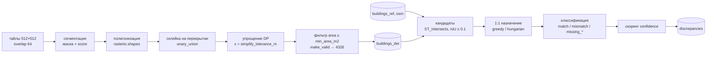

# Глава 4. Разработка алгоритма

Обозначения и полные формулы — `docs/metrics_and_formulas.md`; здесь — логика этапов. Параметры — `config/cv.yaml`, `config/matching.yaml`; первичные описания — `src/geoqc/cv/README.md`, `src/geoqc/matching/README.md`.

## 4.1 Общая схема

Вход: снимок AOI (COG, метрическая UTM) и векторный слой (`buildings_ref`). Выход: таблицы `matches` (совпадения) и `discrepancies` (очередь расхождений с классом и уверенностью), экспорт `reports/discrepancies.geojson`.

Все метрические операции (площади, IoU, допуски) выполняются в UTM-зоне AOI; хранение — EPSG:4326.

## 4.2 Детекция зданий

Предиктор реализует интерфейс `Predictor.predict(tile) -> list[Mask]` с двумя реализациями: instance-сегментация Ultralytics YOLOv8-seg и семантическая U-Net (`segmentation_models_pytorch`). Устройство выбирается автоматически (CUDA / MPS / CPU), инференс батчами по тайлам, half-precision на CUDA.

Бейзлайн — предобученный чекпоинт сегментации зданий (источник и лицензия — `models/MODEL_CARD.md`); при провале гейта G3 на `val` выполняется дообучение в ноутбуке `notebooks/train_finetune.ipynb` (D-004) на `labels/val` (внутренний сплит 80/20) и, опционально, открытых наборах INRIA/SpaceNet. Версия модели — `model_version = "<model_name>-<sha256(weights)[:8]>"`, записывается в каждую детекцию и в `metrics.json` (`{{metrics.model.model_version}}`).

Порог уверенности `conf_threshold` подбирается перебором на `val` по F1 при IoU ≥ 0.5 (`geoqc cv threshold-sweep`, результат `reports/threshold_sweep_val.json`); выбранное значение — `{{metrics.model.conf_threshold}}`. `test` в подборе не участвует.

## 4.3 Векторизация

1. **Полигонизация**: бинарная маска тайла → полигоны (`rasterio.features.shapes`), перенос из пиксельных координат через affine-трансформацию тайла; каждому полигону приписывается `score` экземпляра (или средняя вероятность по маске для U-Net).
2. **Склейка на перекрытии**: объекты разных тайлов объединяются транзитивно (union-find), если IoU ≥ `tile_overlap_merge_iou` или доля пересечения от меньшей площади ≥ `min_overlap_ratio` (второе условие ловит фрагмент, отсечённый краем тайла); группа → `unary_union`; `score` — максимум (`score_mode: max`) либо взвешенное по площади. Без этого шага здание на границе тайлов дало бы два фрагмента и ложные расхождения.
3. **Упрощение Дугласа–Пекера** с допуском `simplify_tolerance_m` (0.5 м): убирает пиксельную «лестницу» контура, сохраняя углы зданий.
4. **Фильтр площади** `min_area_m2` (12 м²) — против шума; согласован с минимальной площадью протокола разметки.
5. `make_valid`, приведение к MultiPolygon, перепроецирование в EPSG:4326, запись в `detections.geojson` и `buildings_det`.

## 4.4 Сопоставление 1:1

Кандидаты — пары (объект OSM, детекция) с пересечением по GiST-индексу и IoU ≥ `iou_mismatch_min` (0.1); IoU считается в SQL функцией `geoqc_iou` в метрической CRS. Назначение 1:1:

- **жадное** (`geoqc_match_greedy`): пары по убыванию IoU, каждая сторона используется один раз;
- **венгерское** (`scipy.optimize.linear_sum_assignment` по компонентам связности графа пересечений): максимизирует суммарный IoU и разрешает конфликты «одна детекция на два здания».

Выбор — `config/matching.yaml → algorithm`. Пары с IoU ≥ `iou_match` (0.5) записываются в `matches` (D-008) и в очередь не попадают; они нужны для метрики среднего IoU (G5).

Предобработка: детекции с попарным IoU > `dedup_iou` (0.7) подавляются (NMS, подавленные — в `det_suppressed`); мультиполигональные детекции разбиваются по частям; объект вне AOI, сжатой на `aoi_edge_buffer_m`, получает флаг `aoi_edge`.

## 4.5 Классификация расхождений

| Класс | Условие | Геометрия задачи |
|---|---|---|
| `geometry_mismatch` | лучшая пара с $0.1 \le \mathrm{IoU} < 0.5$, обе стороны без совпадения | объединение пары |
| `missing_in_map` | детекция без пары, max IoU с OSM < 0.1 | детекция |
| `missing_on_image` | объект OSM без пары | объект OSM |

Класс `missing_on_image` смешивает три причины — снос, ошибка карты, пропуск модели (тени, деревья); разделить их без второго источника и разновременных снимков нельзя, поэтому класс ранжируется признаком согласия со вторым источником и контекстом (п. 4.6) и интерпретируется при ручной верификации (гл. 6).

## 4.6 Скоринг уверенности

Уверенность расхождения $c \in [0,1]$ — взвешенная сумма признаков в $[0,1]$; веса класса (`config/matching.yaml → weights`) нормируются на сумму 1, при отсутствии второго источника член $w_S$ исключается с перенормировкой; реализация — `src/geoqc/matching/scoring.py`, полная запись — `docs/metrics_and_formulas.md` §6:

$$
\begin{aligned}
c_{\texttt{missing\_in\_map}} &= w_s\, s + w_a\, a_{\mathrm{norm}} + w_S\, \mathrm{agree}_S,\\
c_{\texttt{missing\_on\_image}} &= w_a\, a_{\mathrm{norm}} + w_S\,(1-\mathrm{overlap}_S) + w_c\,(1 - m_D(r)),\\
c_{\texttt{geometry\_mismatch}} &= w_s\, s + w_{\mathrm{iou}}\,(1-\mathrm{IoU}) + w_a\, a_{\mathrm{norm}},
\end{aligned}
\qquad
a_{\mathrm{norm}} = \operatorname{clip}\!\left(\tfrac{\ln(\mathrm{area}/a_{\min})}{\ln(a_{\max}/a_{\min})},0,1\right).
$$

Смысл признаков: $s$ — уверенность модели; $a_{\mathrm{norm}}$ — логарифмически нормированная площадь между `min_area_m2` и `max_area_m2` (крупные объекты важнее и надёжнее); $\mathrm{agree}_S = \mathrm{overlap}_S = \mathrm{cov}_S$ — доля площади объекта, покрытая вторым источником (для пропуска на карте покрытие MS/Google повышает уверенность; для «снесённого» — его отсутствие там); $m_D(r)$ — максимальный IoU объекта OSM с любой детекцией (если детекция рядом всё же есть, вероятнее смещение, чем снос); $(1-\mathrm{IoU})$ — величина геометрического расхождения. Итог умножается на `aoi_edge_factor` для объектов у границы AOI (обрезка снимка). Очередь сортируется по $c$ по убыванию; качество ранжирования измеряется precision@N (гл. 6).

## 4.7 Экспорт очереди

`geoqc matching export` → `reports/discrepancies.geojson` (контракт §3.8): Feature на задачу с `id, class, confidence, iou, status, ref_osm_id, model_version, created_at`. Формат пригоден для загрузки в MapRoulette и открытия в JOSM; тот же контракт отдаёт API (`GET /export`).

## 4.8 Обработка краевых случаев

- Граница AOI: объекты, пересекающие буфер `aoi_edge_buffer_m`, помечаются и понижаются в ранге.
- Граница тайла: решается перекрытием и склейкой (п. 4.3).
- Здания под деревьями и в тени: типовой источник `missing_on_image`; анализируется в `reports/error_analysis.md`; fallback плана — признак NDVI при наличии NIR-канала или понижение приоритета класса.
- Разновременность: обе даты в манифесте; интерпретация `missing_*` — в верификации.
